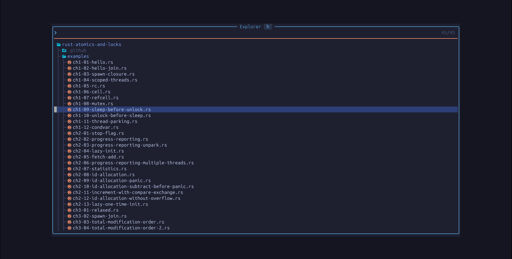
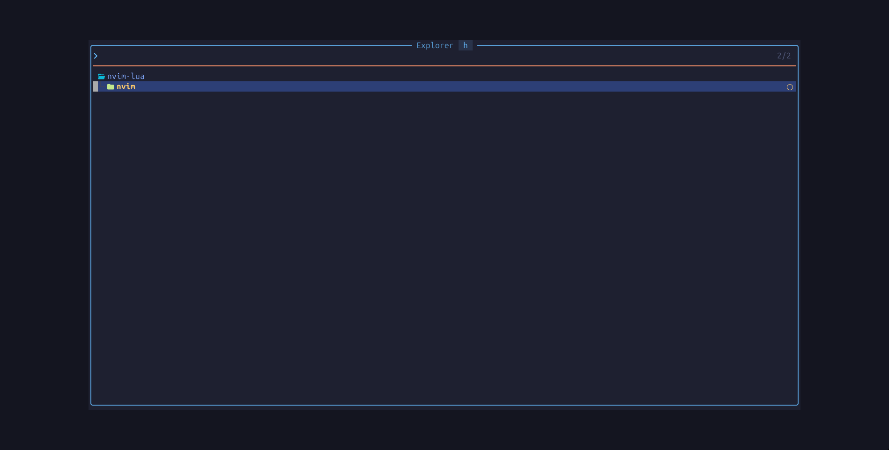
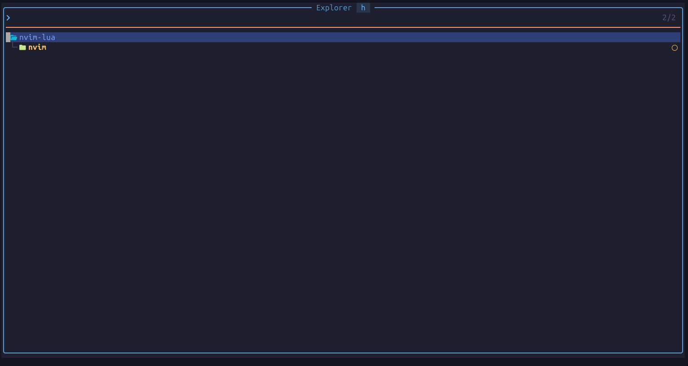

# 💤 LazyVim

A starter template for [LazyVim](https://github.com/LazyVim/LazyVim).
Refer to the [documentation](https://lazyvim.github.io/installation) to get started.

  



```

:lua Snacks.picker.highlights({pattern = "hl_group:^Snacks"})

SnacksPickerIconEnumMember
SnacksFooter
SnacksPickerFooter
SnacksPickerLabel
SnacksPickerBox
SnacksPickerGitStatusCopied
SnacksPickerGitStatusRenamed
SnacksPickerList
SnacksPickerInput
SnacksPickerPreview
SnacksPickerBoxCursorLine
SnacksPickerInputCursorLine
SnacksPickerListTitle
SnacksDashboardTerminal
SnacksPickerIconEnum
SnacksPickerPreviewTitle
SnacksPickerBoxBorder
SnacksPickerListBorder
SnacksPickerIconBoolean
SnacksPickerPreviewBorder
SnacksPickerToggleRegex
SnacksPickerIconStruct
SnacksPickerToggleFollow
SnacksPickerToggleHidden
SnacksPickerToggleIgnored
SnacksPickerToggleModified
SnacksPickerIconKey
SnacksWinBarNC
SnacksPickerBoxFooter
SnacksPickerListFooter
SnacksPickerInputFooter
SnacksPickerPreviewFooter

# example  Жовті кружечки — це позначки Git-статусу (змінені файли) або LSP-попередження.

Extmarks
  - SnacksPickerGitStatusModified links to DiagnosticWarn

SnacksPickerGitStatusModified = {
  default = true,
  link = "DiagnosticWarn"
}

DiagnosticWarn = {
  bold = true,
  cterm = {
    bold = true
  },
  fg = "#FFCB6B"
}


```

# Основні вікна Picker (Пошуку)

SnacksPickerBox: Головне плаваюче вікно-контейнер, яке об'єднує всі елементи пошуку.
SnacksPickerInput: Рядок введення, де ви друкуєте свій запит для пошуку.
SnacksPickerList: Основний список результатів пошуку.
SnacksPickerPreview: Вікно попереднього перегляду (показує вміст файлу або іншу інформацію про обраний елемент).

# Рамки та Заголовки (Borders & Titles)

SnacksPickerBoxBorder: Рамка навколо головного вікна-контейнера.
SnacksPickerListBorder: Рамка навколо списку результатів.
SnacksPickerPreviewBorder: Рамка навколо вікна попереднього перегляду.
SnacksPickerListTitle: Текст заголовка над списком результатів.
SnacksPickerPreviewTitle: Текст заголовка над вікном попереднього перегляду.

# Нижні панелі (Footers)

SnacksFooter: Загальний стиль для нижніх панелей у плагінах Snacks.
SnacksPickerBoxFooter: Нижня панель головного вікна-контейнера.
SnacksPickerInputFooter: Нижня панель під рядком введення (зазвичай порожня або для підказок).
SnacksPickerListFooter: Нижня панель під списком результатів (часто показує загальну кількість знайдених елементів).
SnacksPickerPreviewFooter: Нижня панель під вікном попереднього перегляду (може показувати шлях до файлу або тип).

# Курсор та Активні рядки

SnacksPickerInputCursorLine: Підсвічування рядка, де знаходиться курсор у полі введення (якщо воно багаторядкове).
SnacksPickerBoxCursorLine: Підсвічування активного рядка в межах головного контейнера.

# Індикатори стану та Тоггли (Toggles)

SnacksPickerToggleRegex: Іконка/текст, що показує, чи увімкнено пошук за регулярними виразами (Regex).
SnacksPickerToggleFollow: Індикатор режиму "Follow" (автоматичне оновлення прев'ю при русі по списку).
SnacksPickerToggleHidden: Індикатор того, що приховані файли (hidden files) включені в пошук.
SnacksPickerToggleIgnored: Індикатор того, що ігноровані файли (з .gitignore) включені в пошук.
SnacksPickerToggleModified: Індикатор того, що показуються лише змінені (modified) файли.
SnacksPickerGitStatusCopied: Колір іконки статусу Git для скопійованих файлів.
SnacksPickerGitStatusRenamed: Колір іконки статусу Git для перейменованих файлів.

# Іконки та Мітки (Icons & Labels)

SnacksPickerLabel: Стиль для текстових міток (наприклад, категорій у результатах пошуку).
SnacksPickerIconEnum: Колір іконки для перелічень (Enum).
SnacksPickerIconEnumMember: Колір іконки для елементів перелічення.
SnacksPickerIconBoolean: Колір іконки для булевих значень (true/false).
SnacksPickerIconStruct: Колір іконки для структур (Struct).
SnacksPickerIconKey: Колір іконки для ключів (наприклад, у JSON або словниках).

# компоненти Snacks

SnacksDashboardTerminal: Стиль для вбудованого терміналу на стартовому екрані (Dashboard).
SnacksWinBarNC: Стиль для рядка стану вікна (WinBar) у неактивному (non-current) вікні.

# описання поточного плагіна

1. Розширений файловий експлорер (explorer)
   Коли ви відкриваєте експлорер, він показує приховані файли (hidden = true) і вимикає бічне вікно попереднього перегляду (preview = false), щоб зосередитися на списку файлів. Для файлів у цьому списку налаштовано 7 потужних кастомних дій:
   Копіювання шляхів (y): Відкриває меню вибору, щоб скопіювати в буфер обміну ім'я файлу, розширення, повний шлях, шлях відносно проєкту або URI.
   Пошук у директорії (s): Запускає ripgrep (rg) для пошуку тексту тільки всередині папки обраного файлу, ігноруючи сміття (.git, node_modules, dist тощо).
   Порівняння файлів (D): Дозволяє виділити два файли і відкрити їх у вертикальному diff-режимі.
   Відкрити зовні (o): Відкриває файл або папку в стандартній програмі вашої ОС (Finder, Explorer або через xdg-open).
   Перейменування (r): Асинхронно перейменовує обраний файл або папку.
   Git Stage/Unstage (g): Перевіряє статус файлу в Git і додає його в індекс (git add) або прибирає звідти (git restore --staged).
   Створення файлу/папки (N): Дозволяє створити новий файл або директорію (якщо шлях закінчується на /) відносно поточної папки.

2. Глобальні гарячі клавіші (Fuzzy Finder)
   Конфіг налаштовує зручні комбінації з <leader> для швидкого виклику різних типів пошуку:
   <leader>se — Відкрити файловий експлорер.
   <leader>ff або <leader>sf — Пошук файлів у проєкті.
   <leader>fg або <leader>sg — Пошук тексту (Grep) у проєкті.
   <leader>fb — Перемикання між відкритими буферами.
   <leader>fr — Список нещодавно відкритих файлів.

3. Vim-команди
   Створює зручні команди для виклику з командного рядка Neovim:
   :SnacksExplorer
   :SnacksGrep
   :SnacksFiles
